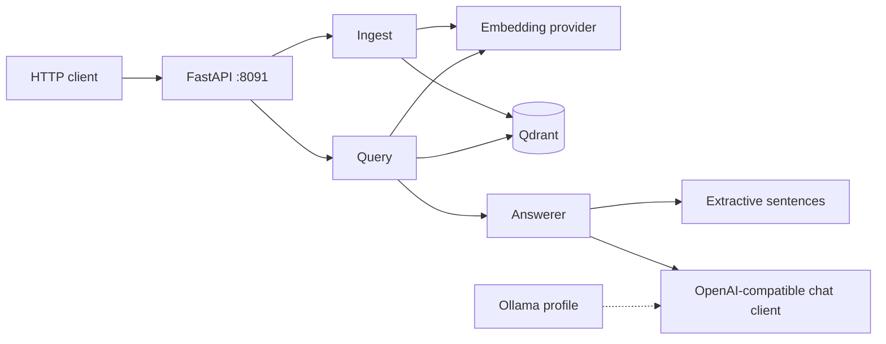

# ragship

[](https://github.com/Howeverqhyn/ragship/actions/workflows/ci.yml)

ragship is a small retrieval-augmented generation service you can run with Docker Compose. Ingest PDF, Markdown, or TXT, then ask questions against those documents.

The default path needs no API key and no model download. Embeddings are an offline hash, vectors live in Qdrant (or in memory), and answers are sentences copied from the retrieved chunks. Point the same OpenAI-compatible client at Ollama or at the OpenAI API when you want a generated answer.

This is a local portfolio service. It has no authentication.

## Architecture



1. **Ingest** reads a PDF, Markdown, or TXT file, splits it into overlapping character windows, embeds each window, and upserts the vectors. Sending the same source name again replaces that source.
2. **Query** embeds the question, reads the nearest chunks from Qdrant, and answers. With no `OPENAI_BASE_URL`, the answer is the retrieved sentence with the most token overlap. With a base URL, one chat-completions client calls that endpoint.
3. **Eval** loads `demo/corpus` into an in-process Qdrant and reports Recall@k against `demo/eval/labeled.jsonl`. It does not use a running Qdrant server.

Embeddings:

| `EMBEDDING_PROVIDER` | What it does |
| --- | --- |
| `hash` (default) | Signed feature hashing. Offline, deterministic, no GPU. |
| `sentence-transformers` | Optional neural encoder. Install the extra; it downloads a model. |
| `openai` | `POST {OPENAI_BASE_URL}/embeddings`. Set `EMBEDDING_DIM` to the model's size. |

`QDRANT_URL=memory` (also `:memory:`) uses Qdrant inside the API process. That is the default for local serve, eval, and pytest. Compose points the API at the `qdrant` service.

## Quick start

Local, with no database and no API key:

```bash
python -m venv .venv
source .venv/bin/activate
pip install -e ".[dev]"
python -m ragship eval
python -m ragship serve
```

The API listens on port **8091**. Data in memory mode disappears when the process stops.

Docker Compose, with a real Qdrant:

```bash
docker compose up --build -d
curl -s localhost:8091/health
```

`docker compose` reads `.env` for variable substitution. Copy `.env.example` to `.env` when you want to override the defaults. Leave the OpenAI variables empty to keep extractive answers.

Ollama is a Compose profile. It is not started by a plain `up`, and it is not required:

```bash
docker compose --profile ollama run --rm ollama pull llama3.2
OPENAI_BASE_URL=http://ollama:11434/v1 MODEL=llama3.2 LLM_PROVIDER=openai \
  docker compose --profile ollama up --build
```

Hosted OpenAI, from the shell or from `.env`:

```bash
OPENAI_BASE_URL=https://api.openai.com/v1 \
OPENAI_API_KEY=your-key-here \
MODEL=gpt-4o-mini \
LLM_PROVIDER=openai \
python -m ragship serve
```

Use your own key. This repository does not ship one. `MODEL` can be omitted for `api.openai.com`; it defaults to `gpt-4o-mini`. Any other base URL, including Ollama, requires `MODEL`.

Neural embeddings are optional and download a model:

```bash
pip install -e ".[sentence-transformers]"
EMBEDDING_PROVIDER=sentence-transformers python -m ragship serve
```

Changing `EMBEDDING_DIM` recreates the Qdrant collection on the next startup when the stored size does not match.

## Demo curls

```bash
curl -s localhost:8091/health

curl -s -F "file=@demo/corpus/architecture.md" localhost:8091/ingest

curl -s localhost:8091/ingest \
  -H 'content-type: application/json' \
  -d '{"source":"note.txt","text":"Ragship answers from retrieved passages."}'

curl -s localhost:8091/query \
  -H 'content-type: application/json' \
  -d '{"query":"Which TCP port does the ragship HTTP API listen on?","top_k":3}'
```

A PDF or `.txt` file uses the same `file` field as the Markdown example. Uploads are limited to 20 MB. `/query` returns:

```json
{
  "answer": "The ragship HTTP API will listen on TCP port 8091.",
  "mode": "extractive",
  "sources": [
    {
      "chunk_id": "architecture.md#0",
      "source": "architecture.md",
      "score": 0.42,
      "text": "..."
    }
  ]
}
```

`mode` is `extractive` or `openai`.

## Environment variables

| Variable | Default | Role |
| --- | --- | --- |
| `QDRANT_URL` | `memory` | `memory` or a server URL such as `http://qdrant:6333`. |
| `QDRANT_COLLECTION` | `ragship` | Collection name. |
| `EMBEDDING_PROVIDER` | `hash` | `hash`, `sentence-transformers`, or `openai`. |
| `EMBEDDING_MODEL` | provider default | Model id for the neural and OpenAI embedders. |
| `EMBEDDING_DIM` | `384` | Vector size. Must match the embedding model. |
| `OPENAI_BASE_URL` | empty | Chat (and OpenAI embeddings) base URL, including `/v1`. Empty selects extractive answers. |
| `OPENAI_API_KEY` | empty | Bearer token. Ollama does not need one. Sent only when set. |
| `MODEL` | empty | Chat model name. Required unless the base URL is `api.openai.com`. |
| `LLM_PROVIDER` | auto | `extractive` or `openai`. Auto uses `openai` when `OPENAI_BASE_URL` is set. |
| `CHUNK_SIZE` | `800` | Characters per chunk. |
| `CHUNK_OVERLAP` | `120` | Characters shared by neighboring chunks. |
| `TOP_K` | `5` | Chunks retrieved when `/query` omits `top_k`. |
| `HOST` / `PORT` | `0.0.0.0` / `8091` | Bind address for `python -m ragship serve`. |
| `RAGSHIP_CONFIG` | `configs/default.yaml` | YAML defaults. Environment variables win. |
| `RAGSHIP_INTEGRATION` | unset | Set to `1` to run the live Qdrant test. |

## Eval

```bash
python -m ragship eval
python -m ragship eval --k 5 --dataset demo/eval/labeled.jsonl --corpus demo/corpus
```

Recall@k is the fraction of gold source ids present in the top-k retrieved sources, averaged over the labeled queries. The command prints `recall@k` and exits `0` when that score is at least `eval.min_recall` in the config (1.0 for the demo set). Eval always builds a fresh in-memory collection, so a remote `QDRANT_URL` is ignored.

## Development

```bash
pip install -e ".[dev]"
ruff check src tests
pytest
```

Pytest uses hash embeddings and in-process Qdrant. The OpenAI client is exercised with a mock transport. Nothing in the default test run calls a network model.

The live Qdrant test stays skipped unless you opt in:

```bash
RAGSHIP_INTEGRATION=1 QDRANT_URL=http://localhost:6333 pytest tests/test_integration.py
```

GitHub Actions runs `ruff check` and `pytest` on push and pull request.

## Layout

```text
src/ragship/
  api/          FastAPI app, routes, schemas
  ingest/       PDF, Markdown, TXT loaders, chunker, pipeline
  retrieval/    hash / sentence-transformers / openai embedders, Qdrant, retriever
  llm/          extractive answerer and one OpenAI-compatible chat client
  eval/         Recall@k
  __main__.py   python -m ragship serve | eval
configs/default.yaml
demo/corpus/    documents for the labeled eval
demo/eval/labeled.jsonl
tests/
```
